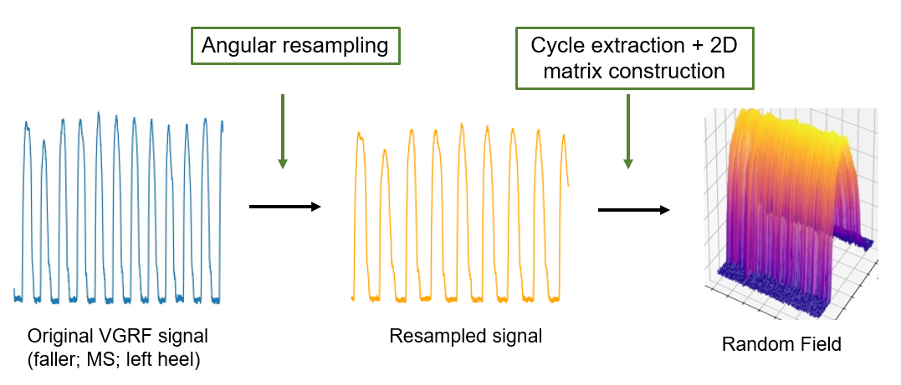
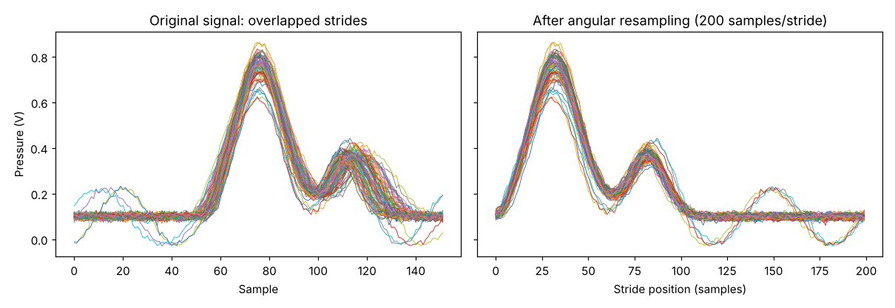
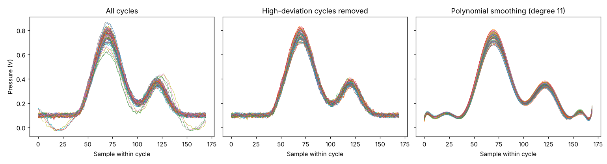
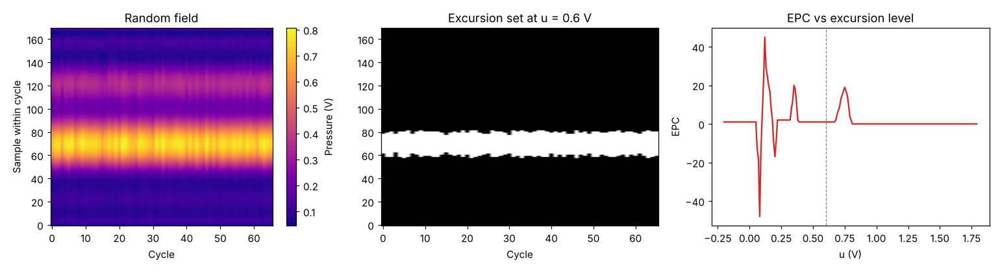
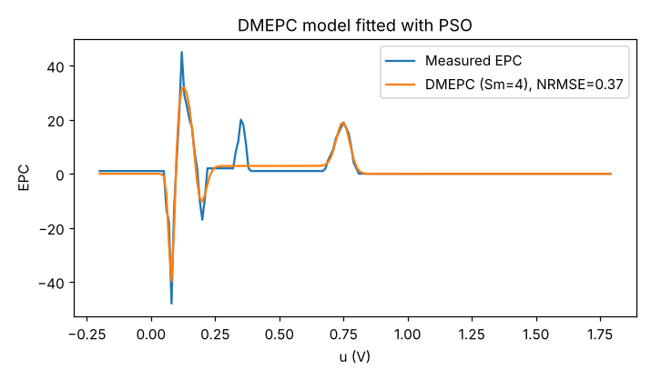
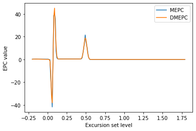
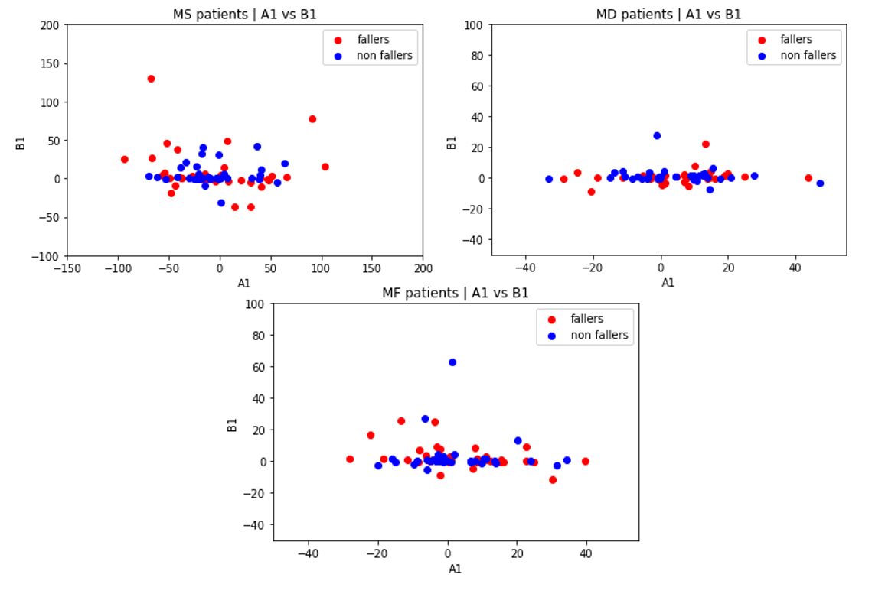
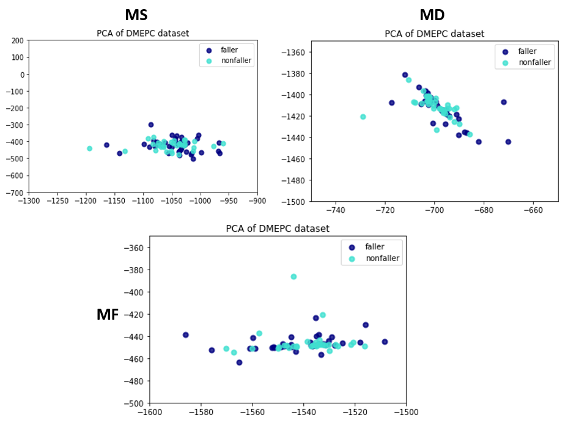

# Topological Gait Analysis with the Euler-Poincaré Characteristic

Can the **topology** of gait signals tell elderly fallers from non-fallers? This project turns foot-pressure signals into 2D **random fields** and describes them with the **Euler-Poincaré Characteristic (EPC)**, a topological invariant from random field theory. The EPC curves are then summarized with a **Decomposed Mean EPC (DMEPC)** model fitted by **Particle Swarm Optimization (PSO)**.

Research internship at the **Laboratoire d'Analyse des Signaux et des Processus Industriels (LASPI), IUT de Roanne, France** (September–December 2022). Supervised by Christophe Corbier, Frédéric Bonnardot and Fidel E. Hernández Montero.



## Pipeline

```
Pressure signal ──> Angular resampling ──> Random field ──> Excursion sets ──> EPC curve ──> DMEPC (PSO)
  (128 Hz)          (200 samples/stride)   (cycles x 170)   (binary images     (EPC vs u)    (16 parameters
                                            cleaned + RAP     at levels u)                     per signal)
```

1. **Angular resampling** (`epc_gait/resampling.py`): walking speed changes from stride to stride, so the signal is resampled as a function of stride position instead of time. Stride peaks are detected after Savitzky-Golay smoothing. The fundamental frequency is isolated in the Fourier domain, the phase of the analytic signal gives the stride position of each sample, and cubic splines interpolate the signal to 200 samples per stride.
2. **Random field** (`epc_gait/random_field.py`): the cycles are stacked into a matrix (cycles × 170 samples around each peak). Then:
   - The 15% of cycles that deviate most from the mean cycle are removed.
   - Each cycle is smoothed with a polynomial (Random Algebraic Polynomials), because the EPC is very sensitive to small fluctuations. The degree, from 0 to 11, is chosen by the lowest NRMSE.
3. **Excursion sets and EPC** (`epc_gait/epc.py`): for each level *u* (from −0.2 V in 0.01 V steps), the field is thresholded into a binary image. Its EPC (connected components minus holes, with 8-connectivity) is computed with Gray's 2×2 local pattern method: `E = (C1 − C3 − 2·Cd) / 4`.
4. **DMEPC model** (`epc_gait/dmepc.py`): the EPC curves are non-Gaussian, so each one is modelled as a sum of *Sm* = 4 signed Gaussian components (Ramos-Martinez, Corbier et al., 2021):

   `DMEPC(u) = Σ_k s_k [A_k · exp(−X_k²/2) + B_k · Φ(X_k)]`, with `X_k = (u − μ_k) / σ_k`.

   The 16 parameters (A, B, σ, μ) are fitted with PSO by minimizing the NRMSE. Fits with an NRMSE below 0.4 are accepted.

## Demo

The clinical recordings are not public, so the demo runs the full pipeline on a **synthetic heel-pressure signal** with realistic features: 128 Hz sampling, speed fluctuations, stride-to-stride variability, noise and a few abnormal strides.

```bash
pip install -r requirements.txt
python examples/demo.py        # full pipeline, about 15 s; figures saved to docs/figures/
python tests/test_pipeline.py  # tests (also run with pytest)
```

| Angular resampling | Cycle cleaning and polynomial smoothing |
| ------------------ | --------------------------------------- |
|  |  |





To analyze your own signal (a text file with one sample per row):

```bash
python examples/analyze_signal.py my_signal.txt --column 0 --u-max 1.8
```

This saves the EPC curve and the DMEPC parameters as CSV files.

## Results on the clinical dataset

The study used vertical ground reaction force (VGRF) signals collected by LASPI and the University Hospital of Saint-Étienne between 2009 and 2011:
- **Participants:** 53 fallers and 467 non-fallers, aged 85 to 93.
- **Sensors:** pressure sensors under the heel and the metatarsus/toes of each foot, sampled at 128 Hz.
- **Tasks:** normal walking (MS), walking while speaking (MF) and walking while counting backwards (MD).

After excluding signals with fewer than 30 cycles, 49 MS, 45 MF and 42 MD signals were analyzed per group.

| Group | Best NRMSE | Worst NRMSE | Mean NRMSE | Signals rejected (NRMSE ≥ 0.4) |
| ----- | ---------- | ----------- | ---------- | ------------------------------ |
| Fallers MS | 0.06 | 0.50 | 0.24 | 6 |
| Fallers MF | 0.05 | 0.65 | 0.25 | 6 |
| Fallers MD | 0.03 | 0.56 | 0.25 | 6 |
| Non-fallers MS | 0.06 | 0.70 | 0.30 | 10 |
| Non-fallers MF | 0.07 | 0.71 | 0.29 | 10 |
| Non-fallers MD | 0.07 | 0.54 | 0.26 | 4 |

| EPC vs DMEPC (faller, NRMSE = 0.148) | A1 vs B1 by task | PCA of the DMEPC parameters |
| ------------------------------------ | ---------------- | --------------------------- |
|  |  |  |

**Conclusion.** The DMEPC model fits most EPC curves well. However, its parameters **did not separate fallers from non-fallers**: the groups overlap in pairwise parameter plots and in PCA. With these results, the EPC cannot be considered sensitive to the faller condition. A natural next step is to feed the parameters, or metrics derived from them, into a classifier or a formal statistical test.

## About this implementation

The original analysis was done in Jupyter notebooks that depended on the clinical data and on a private signal processing toolbox. This repository is a clean, self-contained re-implementation of the same pipeline, built with NumPy, SciPy and Matplotlib only:
- **Euler characteristic:** implemented directly, and validated against `scikit-image` and against connected-component counts.
- **PSO:** implemented in NumPy with the hyperparameters of the original study (25 particles, w = 0.3, c1 = 1.2, c2 = 2.7, 2000 iterations), plus random restarts.

## Repository structure

```
epc_gait/          Library: resampling, random field, EPC, DMEPC + PSO, synthetic signal
examples/          demo.py (synthetic end-to-end run) and analyze_signal.py (your own data)
tests/             Tests of the EPC computation, resampling and model fitting
docs/figures/      Demo figures; report/ holds figures from the internship report
```

## References

- M. Ramos-Martinez, C. Corbier, V. M. Alvarado, G. L. Lopez, "Decomposed Mean Euler-Poincaré Characteristic Model for a Non-Gaussian Physiological Random Field", *IEEE Access*, vol. 9, pp. 21180–21191, 2021.
- R. J. Adler, J. E. Taylor, *Random Fields and Geometry*, Springer, 2007.
- S. B. Gray, "Local Properties of Binary Images in Two Dimensions", *IEEE Transactions on Computers*, C-20(5), pp. 551–561, 1971.
- F. Bonnardot, M. El Badaoui, R. B. Randall, J. Danière, F. Guillet, "Use of the acceleration signal of a gearbox in order to perform angular resampling (with limited speed fluctuation)", *Mechanical Systems and Signal Processing*, 19, pp. 766–785, 2005.

## Author

**Elías García Alvaredo**: [LinkedIn](https://www.linkedin.com/in/elias-garcia-9063721b7/) · [GitHub](https://github.com/eliasalvaredo)
